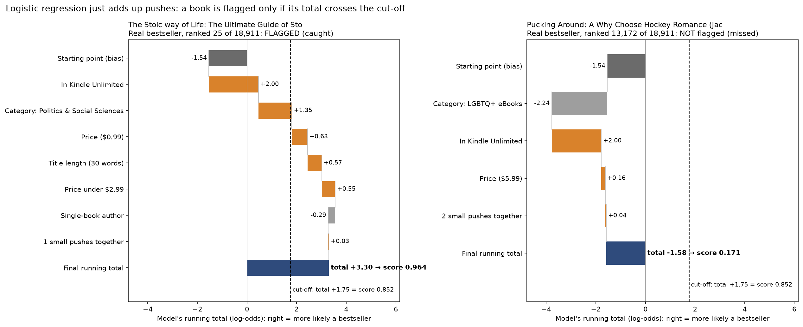

# Logistic Regression from Scratch: Kindle Bestseller Detection

**PDAN8412 POE Part 2** · Louis Francois Fourie (ST10152431)

A book press wants to know, **before** investing in a book, how likely it is to become a bestseller, and **which** characteristics make that more likely. This project answers both questions with a logistic regression written from scratch in NumPy (sigmoid, weighted log loss, L2 regularisation and gradient descent, with no machine-learning library doing the training), trained on 126,079 Amazon Kindle books.

## Headline result

Using only facts known **before launch**, the model ranks bestsellers at almost **four times the rate of random guessing**. If the press reviews only the model's **top 20%** of books, it finds **63% of all bestsellers**.

| Method (held-out test set: 18,911 books, used once) | Test PR-AUC (95% CI) | Compared with guessing |
|---|---|---|
| Random guessing | 0.018 | 1.0× |
| Rule: "in Kindle Unlimited" only | 0.033 | 1.8× |
| Rule: category bestseller rate | 0.031 | 1.7× |
| **Set A: pre-launch features (recommended)** | **0.067 (0.055–0.084)** | **3.8×** |
| Set B: Set A + stars, reviews and age | 0.074 (0.061–0.093) | 4.2× |

- At the chosen cut-off (score ≥ 0.852), **10.6%** of flagged books are real bestsellers, against 1 in 57 (1.8%) when picking at random.
- Waiting for after-launch signals (Set B) adds **at most a small gain**, so the decision can be made before launch.
- PR-AUC is used instead of accuracy because only 1.77% of books are bestsellers: a model that always answers "no" is 98.2% accurate and finds nothing.



## What the model learned

Odds multipliers from the Set A weights, all other features held equal (categories compared with Mystery, Thriller & Suspense; publishers compared with Amazon):

- **Kindle Unlimited ×7.4**: the strongest broad signal, and it holds in all 31 categories.
- **Non-fiction outranks genre fiction**: e.g. Children's eBooks ×7.4, Nonfiction ×5.3, against Romance ×0.31.
- **"A Novel" in the title ×0.41**: it marks traditionally published fiction.
- Prices **below $2.99** push a book up.

These are associations, not causes.

## Known blind spots

- **Free books from publishers other than De Marque are over-ranked**: only 2.7% of those flagged are bestsellers.
- **Bestsellers outside Kindle Unlimited are mostly missed**: 93% of the bestsellers it catches are in KU, against 58% of those it misses.

## How it works

1. **Exploratory data analysis**: nine checks, each ending in a decision.
2. **Cleaning**: 7,023 Editors' Pick / Goodreads Choice books removed (their bestseller label cannot be trusted); 58,341 lost review counts set to missing with a flag.
3. **Split by book** (title + author), stratified: 70% train (88,254), 15% validation (18,914), 15% test (18,911), with no book in two portions.
4. **Features fitted on training only**: Set A has 48 columns, Set B 54.
5. **Logistic regression in NumPy**, with 55-to-1 class weights for the rare bestsellers. The gradient was checked numerically (difference 7.26 × 10⁻¹¹) and the weights match scikit-learn's `LogisticRegression` to within 0.0052.
6. **Tuning on validation**: L2 strength (best λ = 0.000001) and the cut-off at the best F1 score.
7. **Test set used once**, then the flagged books were inspected to find the blind spots.

## Repository structure

```
LogisticRegression_BestSellerDetection/
├── notebooks/
│   └── BestsellerPrediction.ipynb     full analysis, run top to bottom
├── reports/
│   └── figures/                       every chart the notebook saves
├── models/
│   └── bestseller_setA_logreg.json    the trained Set A model
├── requirements.txt
└── README.md
```

## Run it yourself

1. Python 3.11 and the packages in `requirements.txt` (pandas 3):
   ```bash
   pip install -r requirements.txt
   ```
2. A Kaggle API token at `~/.kaggle/kaggle.json`, so `kagglehub` can download the data.
3. Open `notebooks/BestsellerPrediction.ipynb` and run all cells. Charts are written to `reports/figures/` and the model to `models/`.

## Use the saved model

`models/bestseller_setA_logreg.json` holds everything needed to score a book: the 48 weights and the bias, the feature order, the cut-off, the training mean and standard deviation used for scaling, the category and publisher lists, and each author's training book count. Load it and score new books with `score_with_saved(books, saved)` from the notebook's final cell:

```python
import json
from pathlib import Path
saved = json.loads(Path("../models/bestseller_setA_logreg.json").read_text())
scores = score_with_saved(new_books, saved)   # new_books: title, author, price, isKindleUnlimited, category_name, publisher_grp
```

The score is a **ranking** (higher means more likely a bestseller), not a percentage chance: the class weights inflate every score.

## Dataset

[Amazon Kindle Books Dataset 2023 (130K Books)](https://www.kaggle.com/datasets/asaniczka/amazon-kindle-books-dataset-2023-130k-books) by asaniczka on Kaggle (`kindle_data-v2.csv`, 133,102 books, 16 columns), scraped from Amazon.com in October 2023. The data is not stored in this repository; the notebook downloads it.

## Limitations

- One snapshot: "bestseller" means "had the badge on the day of the scrape".
- Associations, not causes: the weights show where a book would rank, not what changing it would do.
- The scores are a ranking; they would need calibration before being read as probabilities.